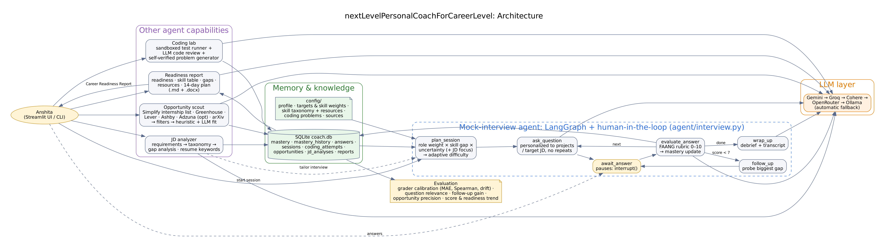

# Agent 2: nextLevelPersonalCoachForCareerLevel
*Anshita Shah · MSSE, San José State University · Build Your Personal Agentic AI Coworkers*

## 1. Agent goals

**Purpose:** prepare me for my next career milestone, a **Summer 2027 ML/AI engineering or cybersecurity internship**, and keep entrepreneurial and research paths visible.

**Expected outcomes**

- A continuously updated pipeline of relevant internships, research leads and startup programs, each scored for fit.
- An honest, FAANG-calibrated picture of my technical readiness per target role, measured from graded answers rather than self-belief.
- Interactive practice that challenges me: adaptive questions, strict rubric grading, follow-up probing and coding tests.
- A **Career Readiness Report** with assessments, strengths, gaps, resources and a 14-day plan, regenerated as I improve.

## 2. Architecture



*LangGraph's own export of the interview graph: `langgraph_interview.png`.*

| Layer | Components |
|---|---|
| **Interview agent** | LangGraph `StateGraph` with a **human-in-the-loop `interrupt()`**: plan → ask → await answer → evaluate → (follow-up when score < 7 \| next question \| wrap-up). Session state is check-pointed (MemorySaver) |
| **Planning** | Skill priority = role weight × (0.7·gap + 0.3·uncertainty) × focus boost. Difficulty adapts to mastery (shifted up for the FAANG-strict style). Subtopics rotate to the least-practised one |
| **Tools** | Job-board APIs (SimplifyJobs internship list, Greenhouse, Lever, Ashby, optional Adzuna), arXiv search, sandboxed Python test runner, JD analyzer, Word exporter |
| **Data sources** | Job postings and descriptions, arXiv papers, a curated taxonomy of 7 skills with reputable free resources (NeetCode, CS229, D2L, Chip Huyen, OWASP, MITRE ATT&CK, NIST, AWS IAM docs, LangGraph docs…), my profile and experience |
| **LLM** | Free multi-provider client with fallback: Gemini → Groq → Cohere → OpenRouter → Ollama |
| **Memory** | SQLite: per-skill mastery + full history, every answer with its rubric, sessions + transcripts, coding attempts, opportunities + status, JD analyses, reports |

**Mastery model:** `m ← m + α·(score/10 × cap(difficulty) − m)`, where `α = max(0.15, 1/(n+3))` and cap = 0.70 (easy) / 0.85 (medium) / 1.0 (hard). Early evidence moves mastery fast; acing easy questions can't inflate it.

**Readiness:** Readiness for a role is the weighted mean of the mastery of its skills, banded as *Not ready / Developing / Interview-ready / Strong*. A confidence label comes from the number of graded answers.

## 3. Working prototype

```bash
pip install -r requirements.txt && cp .env.example .env   # add free GEMINI_API_KEY
streamlit run app.py          # or: python cli.py security_intern 4
```

Demo script (about 4 minutes):

1. **Opportunities:** scan, show fit reasons, and save one posting.
2. **Analyze JD:** show must-have coverage and gaps, then start a tailored interview.
3. Answer one question weakly to show the follow-up probe, and one strongly to show the mastery change.
4. **Coding Lab:** solve the RBAC problem and show the review.
5. **Readiness Report:** generate it and download the .docx.

## 4. Sample results

> Complete 2–3 real sessions before submitting, then attach these files:

- Interactive coaching transcript(s): `sample_output/session_*.md` (saved automatically)
- Career Readiness Report: `sample_output/career_readiness_report_*.docx` / `.md`
- Grader calibration: `eval/calibration_results.json`
- Screenshots: Dashboard and Evaluation tab

## 5. Evaluation

| Dimension | Metric | How it's measured | Target |
|---|---|---|---|
| **Grader accuracy** | Within-range rate | 11 human-labelled reference answers (strong, medium, weak, skipped across 5 skills), graded by the live grader | ≥ 0.8 |
| | Ranking agreement | Spearman correlation between grader scores and human midpoints | ≥ 0.8 |
| | Consistency | mean absolute drift when re-grading the same answer | ≤ 1.0 pt |
| **Question quality** | Relevance | 👍 rate on questions during sessions | ≥ 0.8 |
| | Probing value | follow-up gain: score change from a weak answer to its follow-up | > 0 |
| **Opportunity accuracy** | Precision | saved + applied ÷ (saved + applied + dismissed) | ≥ 0.5 |
| | Filter correctness | unit tests: non-internships, off-track and citizenship-restricted roles are excluded | 100% |
| **Coding** | Pass rate + review score | test cases passed; generated problems are self-verified against a reference solution | rising |
| **User progress** | Score trend | average of later sessions minus earlier sessions | > 0 |
| | Mastery and readiness | per-skill mastery history; readiness per role over time | ≥ 70 = interview-ready |
| | Gap closure | skills moved from below 50% to at least 60% | ≥ 2 within 4 weeks |

**Automated tests:** `python -m tests.test_coach` covers the interview flow, mastery updates, the coding harness (correct, wrong, infinite-loop and syntax-error code), problem self-verification, filters, JD gaps, report formatting, metrics and calibration isolation.

**Limitations and next steps**

- The LLM grader can be lenient or harsh on niche topics; calibration quantifies this, and I can add reference answers.
- Big Tech careers sites lack public APIs and rely on the Simplify list plus pasted JDs.
- Planned: voice answers (speech-to-text) for realistic pacing, spaced-repetition scheduling of weak subtopics, and a calendar node for the 14-day plan.
